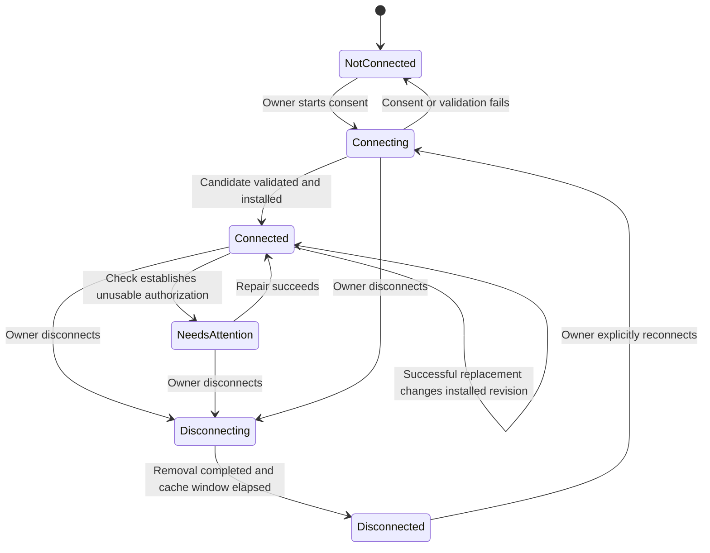

# Stabilize the Google account proxy

Date: 2026-09-30

Status: Implemented and deployed on 2026-09-30. Real Google enrollment and caller acceptance remain pending (0 of 8 connected). See [acceptance evidence](proxy-stabilization-acceptance.md).

Approach: Ponytail — retain the architecture, repair the existing contracts, and finish the usable product.

## 1. Intended outcome

Jay can connect eight or more Google accounts, use Gmail and Drive through this fork of gogcli, understand which accounts and operations a caller can access, recover after interruptions, and remove access. Google credentials stay on the server. The proxy enforces permissions independently of the CLI's voluntary restrictions.

This is a stabilization pass. It supersedes the **remaining direction** of `remote-gmail-onboarding.md`; it does not discard the useful implementation delivered under that plan.

The product's scoped-access contract for this pass is **authenticated caller × Google account × permitted API operations**. Existing path restrictions can also limit specific endpoints or fixed IDs. Folder membership filtering, Gmail label filtering, response redaction, and arbitrary field-level visibility are not promised by the current policy language and are not added here.

Completion has two separately reported gates:

1. **Product ready:** the implementation and its allowed/denied/recovery paths pass the checks below, and real gogcli reads work against an enrolled account.
2. **Jay's enrollment complete:** every supplied account is connected and checked for its selected services, or has a specific recorded Google/Workspace action that Jay or an administrator must complete. A blocked account is not counted as connected. The overall eight-account objective remains incomplete until the outstanding accounts are handled.

## 2. Facts, assumptions, and boundaries

### Current evidence

The 2026-09-30 read-only audit established:

- Source repository: `/Users/jay/Projects/gogcli-proxy`.
- Working branch: `update/gogcli-v0.42.0`.
- The fork already incorporates upstream gogcli v0.42.0. An upstream update is not a prerequisite for this work.
- Production: K-Rae account `968138089939`, region `us-east-2`, stack `GogcliGoogleProxyApi`, stage `prd`.
- Deployment profile: `krae-jdev-dev-prd`; canonical JDev source: `/Users/jay/Projects/development/jdevaws`.
- Stack status was `UPDATE_COMPLETE`.
- There were zero remote Google credential records and zero onboarding `CLIENT`, `SETUP`, `ACCOUNT`, or `OP` records. An owner authentication-session record existed.
- The three historical local account setups are context, not evidence of remote connectivity.
- The 81 Lambda tests passed. That does not establish caller-specific access or a completed live enrollment.

Recheck metadata before implementing a cutover. If accounts or callers have appeared since this observation, inspect their actual nonsecret configuration and prepare a specific conversion before changing its semantics. Do not invent a general migration framework for empty state.

### Known accounts and existing projects

| Account | Recorded Google project | Recorded client |
| --- | --- | --- |
| `jay.jakosky@gmail.com` | `jayj-gogcli-full-access` | Desktop/local |
| `jay@frunkholdings.ltd` | `jay-fhl-gogcli-full-access` | Desktop/local |
| `treasurer@longmonttheatre.org` | `gogcli-ltc-treasurer-full` | Desktop/local |

The remaining addresses must come from Jay, preferably through the page's Add accounts interaction. Do not invent five addresses or display five mandatory empty forms.

The default is to reuse `jayj-gogcli-full-access` and a hosted Web OAuth client. An External Google application can connect personal Gmail and accounts in different Workspace organizations, subject to those organizations' policies. A new Google project is not required per mailbox. Keep the other recorded project contexts available when an organization actually requires another client.

### Retained architecture and defaults

- One administrative owner, using the existing Authentik application and owner group.
- Existing API Gateway, Python proxy/onboarding Lambdas, DynamoDB table, SQS workflow, SSM SecureString storage, and CloudWatch logs.
- Existing SigV4 caller authentication plus the API usage-plan key. The key is not the caller identity.
- Existing account allowlists and policy documents. No new grant database or permission framework.
- Existing trusted owner Developer identity for Jay's own first CLI use. Independent future consumers need distinct IAM principals when they need different permissions; do not provision hypothetical clients now.
- Existing shared Go HTTP transport; no rewrite of the gogcli command inventory or module path.
- Existing transfer limits: transmitted request body at most 4 MiB, serialized Lambda response at most 6 MiB, and the existing bounded request deadline.
- Gmail and Drive are the services enrolled and demonstrated in this pass. Other existing service implementations remain available in source, with access requiring deliberate configuration and separate verification.

### Excluded work

No folder/label filtering engine, content redaction, multiple-owner tenancy, general application-registration portal, redesigned authentication protocol, new release pipeline, scheduled health-check fleet, background Google Cloud administration, or new large-file transfer service. Do not add Google settings scopes, Workspace domain-wide delegation, or additional service scopes simply because upstream exposes commands that use them.

Production verification reads only. It sends no mail and creates, modifies, shares, or deletes no Google content. Destructive lifecycle cases are tested offline or in an authorized disposable test target, not by disconnecting Jay's production accounts as a test.

## 3. Non-negotiable behavior

1. Missing identity, account permission, configuration, or applicable authorization fails closed.
2. A caller deny cannot be overridden by an account allow. A restrictive caller policy cannot inherit unrelated default allows.
3. Policy evaluates the same destination and request representation that is forwarded.
4. Google consent and proxy caller access are distinct facts. The page explicitly shows whether connecting an account also enables Jay's configured tools.
5. Reconnecting preserves installed access until a replacement candidate has passed fresh-token and service-read validation. A failed attempt must not relabel a working installed connection as disconnected.
6. Completed connection state survives operation cleanup. Reconnect, verification, and disconnect start from an account, never from the continued existence of an old operation.
7. Reconnect or delayed workers cannot restore access that the owner has withdrawn.
8. A successful verifier read proves that verifier's named checks at that time. Actual caller readiness is proved using that caller's requests.
9. Browser/API/CLI errors never expose Google tokens, secrets, cookies, OAuth codes, or consent URLs.
10. The page uses observed facts and saved project context; user confirmations remain labeled as confirmations.

## 4. Authorization repair

### 4.1 Keep the current documents; change how they compose

Retain the existing SSM locations:

- `<prefix>/allow/<encoded-caller>`
- `<prefix>/policy/default`
- `<prefix>/policy/caller/<encoded-caller>`
- `<prefix>/policy/account/<encoded-email>`

Replace the shared, priority-sorted merge with these rules:

1. Require a valid default document. The provisioned default remains an empty deny policy.
2. If a caller document exists, it is the source of positive permission. Otherwise the default document is that source.
3. Any matching explicit deny in the default, caller, or account document vetoes the request, regardless of priority.
4. The positive-permission document must independently allow the request; its own `default_effect` applies if no rule matches.
5. If an account document exists, it must independently allow the request too. A missing account document adds no additional restriction.
6. Priority and declaration order may choose the reported rule among equivalent matches; neither can make an allow defeat a matching deny.

An account whitelist uses `default_effect: deny` plus explicit allows. An account denylist uses `default_effect: allow` plus explicit denies. Document this distinction with examples. A malformed configured document fails closed; it is not treated as absent.

Add optional `match.accounts`, an exact list of normalized account emails, to the existing rule schema and validator. The context already carries the selected account. This small addition permits one caller to read Gmail on account A and Drive on account B without introducing grant objects. Empty/absent lists retain the existing unconstrained-match convention; examples must use explicit lists when account-dependent permission is intended.

Update the existing provisioned policies in the same change. This is a breaking semantic correction; document it and remove the obsolete override behavior rather than support two evaluation modes.

### 4.2 Authorize the forwarded request

Perform routing validation and request preparation before policy evaluation or token minting:

- Reject duplicate or ambiguous account/Google-host routing headers, including case variants and API Gateway multi-value representations.
- Reject method-override headers. Caller-controlled overrides must not alter a method after authorization.
- Reject malformed escapes, controls, backslashes, and raw or decoded dot path segments. For Gmail/Drive's relevant identifier paths, reject encoded separators and nested percent encoding that create ambiguous segment boundaries.
- Preserve legitimate escaped opaque identifiers in other existing service routes; do not globally decode the entire path.
- Derive forwarding and policy query information from one parsed multi-value query representation. Preserve repeated parameters and values; reject contradictory event representations rather than validate one and forward another.
- Prepare the outbound URL with the actual HTTP library, ensure its host/path agree with the validated destination, and evaluate/log the final destination. Send that prepared request without another independent path transformation.
- Retain the existing supported-host checks and stripping of proxy authentication/routing headers.

Do not describe the earlier dot-segment reproduction as a proven production exploit. It is a demonstrated handler-boundary mismatch to close with regressions.

### 4.3 Bound revocation without replacing the cache design

Retain token caching. Authorization checks run before a cached Google token can be used.

- Account/allowlist configuration cache: maximum 60 seconds.
- Policy cache: maximum 30 seconds; configuration may shorten but not extend that ceiling.
- After a durable removal, newly starting requests must be denied within 60 seconds.
- A request authorized before the change is observed may finish within the existing 27-second budget. Do not call revocation instantaneous.
- UI operations remain in an applying state for at least 65 seconds after the final authorization write. Report the write and propagation timestamps; do not claim a global probe of every warm Lambda instance.

Avoid cache-version broadcasts or a new authorization store. Test the promised bound using a clock and the real cache boundary, including a previously cached Google token.

## 5. Google services and consent

Add one small server-side service registry used by consent, validation, provisioning helpers, and setup responses. The browser renders descriptions supplied by the server. Do not duplicate scope strings throughout the UI or build a generic provider framework.

| Service | Consent in this pass | Supported use | Verification |
| --- | --- | --- | --- |
| Gmail | `gmail.modify` | Mail reading, sending, labels, and modifications allowed by that scope and caller policy | Profile plus at most one message ID |
| Drive | `drive` | Drive API file operations allowed by that scope and caller policy, within existing transport limits | `about` identity plus at most one file ID |

Both include `openid` and email identity. Full Drive scope is intentional for ordinary gogcli Drive operations across existing files; `drive.file` is not an equivalent replacement. The page describes the requested access before consent. Google authorization does not itself give every caller these capabilities.

Default new-account selection to Gmail and Drive, with either service removable before first consent. A Drive-only account must not require a Gmail probe. Gmail settings requiring extra settings scopes, permanent deletion requiring broader Google authorization, Drive Activity/Labels, Docs editing, and Sheets editing are not claimed by these two grants.

Keep per-account requested services and actual returned scopes distinct. Normalize Google's equivalent email scope name. Validate identity, nonce, required selected-service scopes, and refreshability before promotion. Save the actual nonsecret scope evidence in account metadata, not a hardcoded global `SCOPES` constant.

For reconnect, default to the installed services and allow adding the other supported service. This pass does not add an incremental scope-removal workflow; callers can be narrowed with policy or access can be removed. Do not silently drop an installed service during a repair attempt.

Populate an account policy for the selected supported service set as part of managed enrollment. It is an additional ceiling under section 4, including when Google returns a token with previously granted broader scopes. This reuses the existing policy store. For a fresh managed account, generate the simple service whitelist and record its canonical content hash in account metadata. Before rewriting it, compare the actual stored document with that hash. A missing ownership hash or content mismatch identifies operator-managed configuration: preserve it and stop automatic replacement with a specific operator-action conflict. The operator must explicitly reconcile the selected-service ceiling before that enrollment proceeds. Do not implement arbitrary regex-policy intersection or silently overwrite a tightened policy. No general policy editor is required.

Provision the owner's caller policy for the supported Gmail and Drive API prefixes and required verbs, while per-account policy/allowlists supply the narrower account boundary. Keep the verifier policy GET-only for exact probe endpoints. Preserve native error results for operations Google does not authorize; diagnostics should identify missing service authorization rather than prescribe local OAuth.

Update AWS invocation grants in coordination with these concrete resources under this API and `prd`: `*/gmail/*`, `*/drive/v3/*`, `*/upload/drive/v3/*`, `*/resumable/upload/drive/v3/*`, and `GET/proxy/v1/accounts`. The current Drive SDK uses `www.googleapis.com/drive/v3/` and `/upload/drive/v3/files`; retain the already recognized resumable-upload path as part of the same bounded Drive transfer contract. Current Gmail send commands use JSON/raw-message API requests, not a separate Gmail media upload surface, so do not add a Gmail upload grant in this pass. Record this list in the generated access output and tests. Do not expand the grant to all stages or all API resources.

Use the existing Gmail hosts for `/gmail/v1/` and `www.googleapis.com` for the three Drive prefixes. The owner's service presets allow GET/POST/PUT/PATCH/DELETE, subject to actual Google scopes and the independent caller/account policies. The verifier gets only GET on Gmail profile/messages and Drive about/files. Deny the Google multipart HTTP batch endpoint unless a future change explicitly validates its inner operations; ordinary Gmail/Drive API batch methods remain subject to their normal paths and policies.

Drive upload/download support remains subject to the existing bounds. Check the current SDK's normal small-upload URL sequence, including any resumable URL it returns, offline through the real transport. Every subsequent request must preserve account, destination signing, policy checks, and body bounds. Do not advertise large-file transfer support or issue new direct-download capabilities to bypass these limits.

## 6. Minimal durable account and project state

Use the existing DynamoDB table and SSM secret format. Extend the current records rather than add services or a general relational domain model.

### Project records

- Replace the single global `CLIENT` selector with `CLIENT#<project-id>` records containing the current imported Web-client revision and secret reference.
- Keep the current SSM client-revision secret scheme. Operations pin a client revision when they start.
- `SETUP` stores the default selected project and shared page preferences; project readiness/publishing confirmations belong to the relevant project/client revision.
- Account records store their selected project. New accounts use the prepared shared default; choosing an alternate existing project is an advanced account option.
- Preserve the three historical project names/client types as contextual binding metadata. A Desktop record is not a hosted credential or proof of current Google Console settings.
- Importing a client requires the selected project and exact hosted callback to match. A client replacement invalidates its associated setup confirmations until reviewed.
- Save project confirmations on the matching `CLIENT#<project-id>` record through the project setup PUT route. Its body carries the reviewed client revision; a stale revision returns `409`. Incomplete project context may exist without an imported credential, but `configured` requires a valid saved secret reference and revision. Consent is gated server-side on the current revision's publishing confirmation, not only by a disabled browser button.
- `setup()` must honor the selected project, not let a previously imported global client silently override it.

### Account records

Keep `ACCOUNT#<normalized-email>`. Store these independent facts:

- Email and verified Google subject.
- Selected project and installed client/credential revision.
- Installed selected services and actual granted scopes.
- Installed connection state: `not_connected`, `connected`, `needs_attention`, `disconnecting`, or `disconnected`.
- Explicit desired access for the configured owner caller.
- Latest enrollment/verification/disconnect operation ID and active-operation fencing facts.
- Per-service verification result, checked revision, checking principal, and timestamp.

Credential values remain in SSM SecureString. Neither account inventory nor operations expose secret references, refresh tokens, client secrets, or callback artifacts.

An account with no installed credential remains `not_connected` regardless of a historical local setup. A failed replacement is an attempt failure; retain the installed connection state and its last evidence. An old successful check is displayed with its time, not as a continuously monitored health claim.

### Operations

- Keep OP records and the current stream/SQS delivery and lease machinery.
- Account actions create fresh operations; temporary OP expiry cannot remove account controls.
- Operations identify their kind, account, actor, request fingerprint, pinned client/credential revision, status, timestamps, and safe recovery information.
- Atomically accept a command with a DynamoDB transaction that reserves the scoped idempotency key, creates the operation, and updates the account active pointer/generation under its preconditions. Do this before consent initiation or external effects. Concurrent identical submissions resolve to the accepted operation; different fingerprints conflict. Do not retain the existing lock-before-idempotency-write gap.
- Retain completed attempt diagnostics and their idempotency keys for seven days after terminal completion. Store the safe terminal result on the key record before OP cleanup, so replay does not depend on a deleted OP. Nonterminal work does not disappear through TTL; schedule consent expiry/retry exhaustion through the existing stream/SQS mechanism. Check explicit expiry times rather than rely on asynchronous DynamoDB TTL deletion.
- The replay guarantee lasts through that seven-day retained-key window. After explicit expiry, an old key is rejected with `idempotency_expired` while its record still exists; once TTL removes the key the server cannot recognize it. Clients therefore generate a new key for a newly intended command and never reuse keys. This bounded guarantee must be documented rather than represented as permanent duplicate prevention.
- Idempotency keys are scoped to owner, route/account/action, and environment. Same key plus different request data returns conflict. A replay must not trigger new consent, promotion, or disconnection.
- Keep state/PKCE/nonce binding and the current rule against exchanging an OAuth code twice after an ambiguous outcome.
- Continue an unexpired authorizing attempt only in the matching owner session. Keep the raw state needed to reconstruct its consent URL in the existing encrypted temporary attempt secret; do not put it in account projections, logs, or ordinary operation responses. The authenticated enrollment command can return that consent URL. A deliberate `restart: true`, an expired attempt, or an owner-session mismatch fences/terminalizes the old authorizing attempt and creates fresh bound consent without waiting for a 30-minute lock or OP TTL. A normal enrollment request while validation/promotion is active returns a useful conflict; it does not exchange another code.
- Account-level recovery is distinct from checking installed credentials. If a failed latest attempt still has usable saved tokens/candidate data, start a fresh recovery operation with the pinned client/revision and copied operation-owned artifact references; revalidate refreshability before promotion. Do not make the new operation depend on an old record's continued TTL retention. If artifacts have expired or an exchange outcome is ambiguous and unsaved, return `consent_required` and start fresh consent only through the enrollment action.
- Separate wrong account, missing selected-service permission, declined consent, expired consent, revoked refresh authorization, Google API disabled, Workspace administrator restriction, transient provider failure, and proxy permission denial when the provider response actually supplies that evidence. Use a generic recoverable result when it does not.

`Connecting` represents the latest operation; it does not replace an existing installed connection's state during reconnect.

## 7. Access removal and disconnect

### Owner's caller access

Use `binding.client_role_arn` throughout infrastructure, Lambda environment, and worker behavior. Delete the hardcoded Developer ARN in worker code.

The account page exposes **Allow my tools to use this account** for that configured principal. For new accounts it is checked with an explicit explanation of the selected services; the action is labeled **Connect and enable my tools**. The owner can uncheck it to save only the Google connection. Capture that intent in durable state. Reconnect preserves the current setting and must not silently regrant access.

Turning it off removes the email from the configured caller's existing allowlist. It keeps the Google connection available to the owner and the limited connection verifier. Turning it on requires an installed connection and explicitly adds that email. This is a control for the existing configured owner identity, not a general consumer-management dashboard.

Require explicit-email-only allowlists for the managed owner/verifier during preflight and initialization. If wildcard/domain grants are later introduced, refuse a conflicting account-access toggle with `409 broad_allowlist_requires_operator`; do not claim removal while broader matching permission remains. Preserve unrelated entries and operator configuration. The account connection code must not silently discard domain or wildcard entries to manufacture exclusivity.

Retain the operator-facing policy/allowlist configuration path for other caller identities. Document how an operator removes an explicit account entry or narrows an existing caller policy, including cache timing. Add only a small repository command if the existing tools cannot apply that edit safely; do not introduce a second source of truth for grants.

### Disconnect account

Disconnect means removing the account's usable credentials from this proxy and denying all proxy callers for that account. It does not delete Google content and does not claim to revoke Google's external consent record.

1. Accept the account-level disconnect command durably and mark desired state `disconnected`.
2. Cancel or fence active enrollment/repair work and reject new connection mutations until removal completes.
3. Serialize promotion and disconnect effects with a short conditional lease on the same ACCOUNT record. Reuse the worker lease pattern; a per-OP lease alone is insufficient. Validate the account's current desired state and active operation while holding this lease.
4. Remove the configured owner and verifier email entries using the existing allowlist-update lock. Delete the installed account SSM parameter and temporary candidate secrets that could restore it; deletion also removes the parameter's stored versions. Remove onboarding-managed account policy state, retaining customized operator policy as configuration rather than silently destroying it.
5. Clear the installed-credential projection while retaining a durable disconnected account record and operation result. Stale workers must be unable to publish `connected` over that record.
6. Wait out the stated cache window and report `disconnected`. If a side effect fails, remain in a retryable disconnect operation; never report success after only changing the UI checklist.

Unknown manually configured callers are denied by the missing installed account credentials. Before an explicit later reconnect, inspect any preexisting account permissions and show the configured owner access intent; do not promise that disconnect permanently deleted every operator-managed policy. This pass creates no other consumer grants.

Supply a link to Google's third-party-access settings for the distinct action of revoking the application's Google consent. Explain that removing consent there can affect other connections using that same Google account/application grant. Do not automatically revoke a shared application's Google grant as part of local proxy disconnect.

## 8. HTTP contract changes

Update the existing OpenAPI 3.1 document before implementation. Keep owner session, CSRF, Origin validation, and safe Problem Details. Preserve existing owner-login/Google callback paths.

| Audience | Method and path | Behavior |
| --- | --- | --- |
| Owner | `GET /onboarding/v1/setup` | Project context, setup confirmations, account projections, selected services, safe latest-operation summaries, and CSRF token |
| Owner | `PUT /onboarding/v1/setup` | Save shared preferences/default project; no side effect of replacing the account list |
| Owner | `PUT /onboarding/v1/projects/{projectId}/oauth-client` | Validate/import a Web client for that project; no secret values in response |
| Owner | `PUT /onboarding/v1/projects/{projectId}/setup` | Save reviewed setup/publishing confirmations with an exact current client-revision precondition |
| Owner | `PUT /onboarding/v1/accounts/{email}` | Idempotently add/update a saved account's project and initial service choices; never change installed credentials implicitly |
| Owner | `POST /onboarding/v1/accounts/{email}/enrollments` | Start a fresh connection or reconnect operation; initial selected services and explicit owner-access intent form the fingerprint |
| Owner | `POST /onboarding/v1/accounts/{email}/verifications` | Check installed selected services without repeating consent; fresh durable operation |
| Owner | `POST /onboarding/v1/accounts/{email}/recoveries` | Resume usable saved authorization from the latest failed attempt in a fresh durable operation; otherwise report fresh consent required |
| Owner | `PUT /onboarding/v1/accounts/{email}/access` | Set configured owner-caller access enabled/disabled; idempotent desired state with durable reconciliation |
| Owner | `DELETE /onboarding/v1/accounts/{email}/connection` | Durably disconnect this proxy account; repeated requests return the same pending removal or completed result |
| Owner | `GET /onboarding/v1/operations/{operationId}` | Temporary diagnostic/progress resource; account controls survive its expiry |
| Caller | `GET /proxy/v1/accounts` | Signed, caller-filtered remote inventory; metadata only |

Incomplete mutations return `202` and `Location`; immediate created account metadata returns `201`, existing metadata updates return `200`, and an already completed deletion may return `204`. Owner POST commands require idempotency keys. PUT and DELETE reuse a pending operation for the same desired state. Ordinary competing enrollment or configuration changes return a precise conflict. Access-disable and disconnect are exceptions: accept their restrictive desired state immediately, supersede/fence active enrollment intent, and reconcile effects under the account lease. Final promotion writes to metadata require the current account generation/desired state; an old worker cannot report a connection over an accepted disconnect. Operation responses name the stable target account.

The existing operation-based retry/attempt mutation routes and global OAuth-client route become obsolete once the page switches to account/project routes. Since there are no external clients or saved enrollment records in the observed deployment, replace them together and remove obsolete routes/docs. Retain only the operation GET resource and the existing callback protocol. Reassess this assumption if the preflight inventory changes.

### Caller inventory

Dispatch the exact reserved inventory route after API Gateway-authenticated caller identity is established and before Google account-header/host requirements. It uses the same SigV4 credentials and API key; it does not require a Google host header or account header. Unknown reserved routes return 404 and unsupported methods 405. Never forward `/proxy/v1/` to Google.

Read the existing allowlist and nonsecret ACCOUNT metadata. For explicit email lists, retrieve those account rows directly. For existing domain/wildcard configurations, reuse the current paginated metadata scan and apply the existing allowlist matcher before returning anything. Do not enumerate SSM credentials or read their values for inventory.

Return only visible enrolled account metadata: email, connection state, selected/granted services, and timestamped verification evidence. Include the canonical setup URL. No other owner's configuration, available-but-ungranted account names, project secrets, or operation references are needed.

Missing allowlist fails closed. An empty valid allowlist returns an empty collection. Inventory visibility does not assert authorization for every method of each listed service. Live checks establish actual caller access.

## 9. The account page

Reuse the static HTML/CSS/JavaScript page; no framework or new frontend application.

### Returning-user landing view

- Heading: connect and manage Google accounts.
- Show the three recognized historical accounts as previous setups awaiting a remote connection, unless remote records establish another state.
- Show saved accounts and per-service status first. Display the count actually connected, with a target of eight initially; allow more than eight.
- Provide one Add accounts interaction accepting a single email or pasted comma/newline-separated emails. Validate new entries locally before saving. A bad draft must not block status refresh or work on another account.
- Each account has one primary next action: prepare Google setup, connect, continue/restart consent, check saved connection, or resolve a specific problem.
- Place reconnect, caller-access removal, and disconnect under secondary account actions. Connected accounts do not lead with Reconnect.

### Google setup guide

- Use the selected existing project and exact project-scoped Google Console links.
- Explain that this shared application can connect accounts from different organizations; an organization's administrator may still restrict it.
- Guide one task at a time: enable selected APIs; review audience/branding/data access; prepare a Web client; register the exact callback; upload the downloaded JSON.
- Explain that the historical Desktop client served local software and cannot supply the hosted callback configuration.
- Distinguish imported configuration, user-confirmed Google settings, and verified service access. Do not infer API enablement, publishing, or administrator approval from the credential JSON.
- Review External/production publishing for durable use. If Google reports a policy block, show the actual client identifier and requested scopes with copyable administrator instructions. Do not automatically send messages.
- Keep alternate recorded projects under an advanced choice. Do not require Jay to understand OAuth architecture to connect the next account.

### Interruption and recovery

- Save complete account/project choices before redirecting to Google.
- Reload saved progress on return, page focus, or explicit refresh without first submitting unrelated drafts.
- Reset dirty state after a successful save; unsaved drafts stay local and are clearly distinguishable.
- Show which account is waiting at Google. If no callback arrives, provide a restart action and expiry explanation; do not show an indefinite unexplained spinner.
- After callback, show per-service checks with a reasonable time estimate and allow starting another account while verification runs.
- Expired owner sessions lead back to owner login and a fresh bound consent attempt where necessary. Never ask Jay to paste an OAuth callback URL, code, or secret into chat.
- Failed checks offer the smallest applicable recovery: retry the saved connection, complete Google setup, approve the correct account/services, or reconnect only when durable authorization is unavailable.

Keep AWS signing, SSM, API-key retrieval, and SDK details in advanced integration instructions. The main account flow uses concrete language about accounts, services, permission, and next actions.

## 10. Managed CLI behavior and distribution

Keep existing command names where they remain useful:

| Command | Managed behavior |
| --- | --- |
| `auth list` | Fetch signed remote inventory; preserve JSON/plain output conventions; no local keyring enumeration |
| `auth status` | Show proxy configuration, selected account, nonsecret AWS profile/source information, and whether remote inventory is accessible |
| `auth doctor` | Check the real config parser, AWS credentials, signed inventory, account selection, and recorded service facts |
| `auth doctor --check` | Perform bounded reads through the normal proxy transport as the actual caller; report each selected service separately |
| `auth list --check` | If retained, perform the same bounded per-account probes explicitly; ordinary list remains metadata-only |
| `auth add`, `auth setup`, `auth manage` | Show/open the canonical owner page, with account context if supplied; no loopback OAuth listener or local Google credential storage |
| `auth remove` | Direct the owner to the account's remote access/disconnect controls; do not pretend local token deletion removes remote access |
| `auth alias` | Preserve local account aliases |
| `auth services` | Distinguish upstream command support from this deployment's enrolled services and required permissions |

Remove obsolete local Google-account credential setup/import/export/keyring/service-account enrollment commands from the managed command tree and generated help. Keep unrelated credentials required by ancillary Google Cloud API-key or Pub/Sub workflows scoped to those consumers. Do not delete shared upstream packages merely to achieve a cleaner tree; remove unreachable managed command behavior and any resulting dead code as required by the existing checks.

Use explicit account, configured default, and environment selection with the existing precedence. Resolve automatic selection through remote inventory only when exactly one account is available; zero/multiple accounts produce useful guidance. A locked or absent local keychain must have no effect on managed list, status, doctor, or API requests.

Installation starts with building this repository. Preserve upstream attribution and the module/import path. Version output identifies the proxy fork, upstream base version, and actual source commit. Stop `update` from recommending upstream binaries that omit the proxy transport; report the source-update procedure until this fork has its own maintained artifacts. A new binary distribution pipeline is outside this pass.

## 11. Runtime and deployment changes

Keep the existing AWS topology. Necessary additions are bounded permissions and configuration on existing resources:

- Proxy Lambda gets metadata-only read access to the onboarding table for caller inventory, with its table name bound explicitly.
- Onboarding worker receives the configured owner caller ARN rather than embedding it in source.
- Onboarding receives narrowly scoped account-policy writes and installed-credential deletion needed for the lifecycle above. Keep secrets in the existing SSM prefix and KMS key.
- Owner/verifier policies, selected-service scopes, and canonical JDev invoke grants change together. The verifier's API Gateway/proxy permissions are GET-only. Candidate validation and probes never invoke a Google write, even when the saved account token can authorize writes.
- Canonical JDev currently accepts one Gmail-only `application_api_invoke_arn`. Replace that single-resource binding with `application_api_invoke_arns`, a bounded list of the resources enumerated in section 5. Update the real target-manifest parser, CloudFormation parameter/resource handling, direct runner, registered runner, and contract tests together. Validate exact account/region/API/stage and allowed path patterns for every entry; keep other targets empty. Publish `ProxyInvokeArns` as a JSON-array string in CDK outputs and consume it as a list, not an unvalidated wildcard. Apply only the K-Rae target through the canonical runner; no fleet rollout or dual old/new evaluation path.
- Publish exact access facts in `env/gogcli-prd/access.json` and update docs/OpenAPI with the resulting endpoints and supported routes.
- Keep logs free of Google content and secrets. Record operation ID, account reference, principal, service, phase, safe error code, revision, and check timestamps needed to diagnose these flows.
- Display persisted failed operations on the page. Existing alarms without notification actions must not be described as notifying an operator. Wiring a new notification destination is outside this pass unless an existing authorized project destination is identified.

The account mutation lease must have a duration longer than the bounded worker execution that owns it. Release conditionally by lease owner; retries reclaim an expired lease. All installed-credential/policy promotion, access toggles, and disconnect side effects check the same account fence. Keep external calls outside long-held locks where possible; token validation can finish before the short installation lease is acquired.

Promotion is retryable: validate candidate first, acquire account fence, apply any required **narrowing** ceiling before installing credentials, write the credential revision, reconcile explicitly requested caller access, then update the durable installed projection. On interruption, resume from stored operation/revision facts. Never broaden an operator policy or restore a revoked owner flag just to complete an old attempt.

## 12. Implementation sequence and ownership

Work in small reviewable changes. Existing uncommitted adaptation files belong to earlier work; preserve and review them explicitly. Never stage them incidentally with a new task.

| Order | Work | Exit condition |
| --- | --- | --- |
| 0 | Record baseline, inspect current metadata/policies, reconcile existing dirty adaptation | Confirm actual source/target and whether empty-state replacement remains valid |
| 1 | Policy composition, request normalization, cache-bound tests | Reproduced authorization failures become passing regressions; existing valid proxy paths still work |
| 2 | Project/account state and service registry; account-level durable actions | Gmail/Drive candidates, reconnect, expiry, and revocation contracts work offline without losing installed state |
| 3 | Inventory contract and CLI diagnostics | Caller sees only permitted remote metadata; no managed local-OAuth/keychain path remains |
| 4 | Adapt the existing page and documentation | Browser journey uses saved context, actionable recovery, and explicit owner access |
| 5 | IaC/JDev changes, packaging, rollout | Reviewed source deployed to the explicit target with the exact required permissions |
| 6 | Real owner enrollment and actual CLI checks | First account works, then all supplied accounts are worked through with honest per-service outcomes |

Useful GPT-6.1 Sol medium parallel work after contracts are fixed: policy/request enforcement; account/workflow lifecycle; CLI/inventory; page/browser verification. Assign disjoint implementation files where possible. The primary agent owns shared API/state decisions, integration, deployment, and final acceptance. Do not have agents independently invent overlapping state models.

Use Red → Green → Refactor for the behavioral repairs below. Prefer current helpers, standard-library features, and installed dependencies. Keep source files around 300 lines where practical; split beyond 450 unless cohesion clearly justifies keeping them together.

## 13. Required verification

### Authorization and proxy boundary

- Caller deny plus account allow remains denied.
- A restrictive caller document cannot inherit an unrelated global allow.
- Empty default-deny plus explicit caller allow continues to work.
- Account whitelist and denylist ceilings behave independently.
- `match.accounts` cannot spill a permission into another account.
- Missing/malformed identity, allowlist, policy, and credential configuration fail before a Google request.
- Dot segments, ambiguous encodings, duplicate routing headers, method override, and contradictory query representations fail before a Google request.
- Valid repeated query values, escaped supported identifiers, and prepared forwarding paths remain correct.
- Warm Google token caching does not bypass withdrawn account access or policy; cache tests establish the stated 30/60-second bounds.
- Request/response size and deadline failures remain bounded and actionable.

### Enrollment and lifecycle

- Gmail-only, Drive-only, and combined consent request/validate the intended scopes and probes.
- Wrong account, missing permissions, canceled/expired consent, and callback replay preserve installed credentials.
- Existing Desktop project metadata does not count as a configured hosted client or remote account.
- Switching/importing projects selects the correct client and cannot reuse another project's publishing confirmation.
- Two concurrent enrollments for the same account cannot install competing candidates; different accounts can progress independently.
- Old OP deletion and delayed TTL cleanup do not break account reconnect, verification, disconnect, or idempotency replay.
- A failed reconnect leaves the installed revision/service evidence visible.
- Promotion interrupted between SSM and metadata changes reconciles safely.
- Owner access off stays off across reconnect and delayed work.
- Disconnect racing an active promotion cannot be undone by a stale worker.
- Partial allowlist/secret removal failures remain retryable and never report completed disconnect prematurely.
- Proxy disconnect does not issue a Google content mutation or silently revoke the shared Google application consent.

### Caller inventory and CLI

- Signed inventory exposes only metadata allowed for the caller; reserved routes never reach Google.
- Inventory performs no SSM credential enumeration or account-secret reads.
- A Gmail check does not mark Drive verified.
- Missing local tokens and a locked keychain do not affect managed commands.
- Actual parser-loaded configuration controls the signed endpoint/profile/account selection.
- Zero/one/multiple visible accounts produce the intended selection behavior.
- Live-check denial is reported as caller access failure, distinct from a recorded healthy connection.
- Local Google OAuth commands cannot launch a loopback listener or install irrelevant credentials.
- Install/update output does not recommend replacing this fork with an upstream binary.

### Page acceptance

Use named `agent-browser` sessions. Do not infer the user's authenticated profile. Exercise desktop and narrow/mobile layouts with the existing assets and explicit offline failure fixtures.

- Returning owner sees existing project context and factual account states.
- One invalid draft does not block another account, refresh, or saved progress.
- Refresh does not save unrelated edits; successful saves reset dirty state.
- Closing/reopening during consent or verification preserves useful recovery.
- Account A can verify while the user begins B.
- Correct-account and permission failures give specific next actions.
- Connected services, latest attempt, owner caller access, and disconnect progress remain distinct.
- Keyboard operation, labels, focus, and status announcements remain usable.

### Practical commands and generated assets

Use the existing `just proxy-test` for Lambda behavior. Run focused Go tests for the changed account/auth/proxy packages, the CDK contract tests, OpenAPI validation, and browser checks. Then run the repository's existing full CI gate once after integration, including generated command documentation/agent skills and dead-code checks.

Add small Justfile recipes for the relevant existing checks if useful; do not rewrite upstream build tooling. Existing `make ci` remains the upstream full gate. Run PyYAML-dependent validators with `uv run --with pyyaml`; use the project-local infrastructure environment and rebuild generated assets before packaging.

Record exactly which checks ran and their outcomes. Passing offline tests is not substituted for the live checks below.

## 14. Rollout and real-account acceptance

### Before deployment

1. Review the complete task diff and the exact target binding. Inspect current live stack, caller/account policies, nonsecret account metadata, and credential record counts again.
2. Confirm no override-dependent live policy or newly enrolled account will be broken without an explicit conversion. Preserve any legitimate state discovered since this plan.
3. Validate the synthesized template and permission changes. Update the canonical JDev deployment source for K-Rae only, through its established runner; do not directly edit protected roles or roll changes across other accounts.
4. Prepare task-only commits and identify their source SHAs. Keep the prior working deployment available as a rollback reference; do not plan to roll back to the known authorization defects after credentials are enrolled.

### Deploy and inspect

Deploy this repository to `GogcliGoogleProxyApi` using explicit profile `krae-jdev-dev-prd`, account `968138089939`, region `us-east-2`. Update only the already-authorized project resources and scoped JDev binding. Reuse the existing Authentik application without redeploying shared identity infrastructure.

Check stack completion, owner login, published endpoint facts, static asset revision, signed inventory, and denial behavior without fetching Google content. Confirm that callback secrets and credentials remain absent from execution/application logs. Recheck the source/runtime binding agreement for the configured caller and service routes.

If a rollout fails, pause new enrollment and restore a reviewed compatible version or forward-fix. Keep saved secrets and metadata intact. After an account is deliberately disconnected, a rollback must not restore its credential or grant.

### Connect and prove actual use

1. Open the owner page and start with `jay.jakosky@gmail.com`.
2. Use its existing project, review current Google settings, and import a suitable Web client. Jay completes any required Google login/consent. The agent does not request secret/callback pastes into chat.
3. Observe candidate validation, durable installation, and per-service verifier reads.
4. Configure/build this fork and use the actual owner caller identity to run signed inventory plus minimal Gmail and Drive reads. Gmail reads profile and at most one message ID; Drive reads account identity and at most one file ID. Empty collections pass. Fetch no message bodies, attachments, or file contents for acceptance.
5. Use an explicitly unlisted synthetic address such as `proxy-deny-probe@example.invalid` for a signed read and require the proxy's account-authorization denial before Google is called. Separately use the connected account for a read route outside the configured Gmail/Drive policy, such as Calendar calendar-list, and require `policy_denied` if IAM permits invocation; an earlier API Gateway IAM denial establishes only that outer boundary. If IAM blocks the request first, report that distinction and rely on the handler contract test for the inner policy result. These checks change no production permissions. Offline tests cover mutation denials and destructive lifecycle cases.
6. Add the other known accounts, then the remaining addresses Jay supplies. Reuse the shared prepared Google application unless an observed organization constraint requires one of the alternate project configurations.
7. For each account, record project, selected service authorization, last verifier result, actual caller result, and any specific remaining user/admin step. Record no Google data or secret values.

Keep these published URLs available directly:

- Setup: `https://u5q3kdnam4.execute-api.us-east-2.amazonaws.com/prd/onboarding/`
- Proxy: `https://u5q3kdnam4.execute-api.us-east-2.amazonaws.com/prd/`
- Google callback: `https://u5q3kdnam4.execute-api.us-east-2.amazonaws.com/prd/onboarding/oauth/google/callback`
- Owner callback: `https://u5q3kdnam4.execute-api.us-east-2.amazonaws.com/prd/onboarding/auth/callback`

### Delivery

- Update README, account guide, infrastructure guide, OpenAPI, generated CLI help, and the unreleased changelog for the final behavior.
- Add only non-obvious operational lessons to the ignored root `SKILL.md`; do not commit that file.
- Review and commit task-owned changes using the required Conventional Commit message with Why / What / Impact and a validation footer. Use a temporary message file and `git commit -F`. Do not include unrelated staged work.
- Report source commits, deployed target, checks actually performed, connected-account count, exact outstanding Google actions, and the retained transport/scoping limits.
- Finish when the product-ready and enrollment gates in section 1 are honestly accounted for. Do not expand scope to make the completion report look broader.
