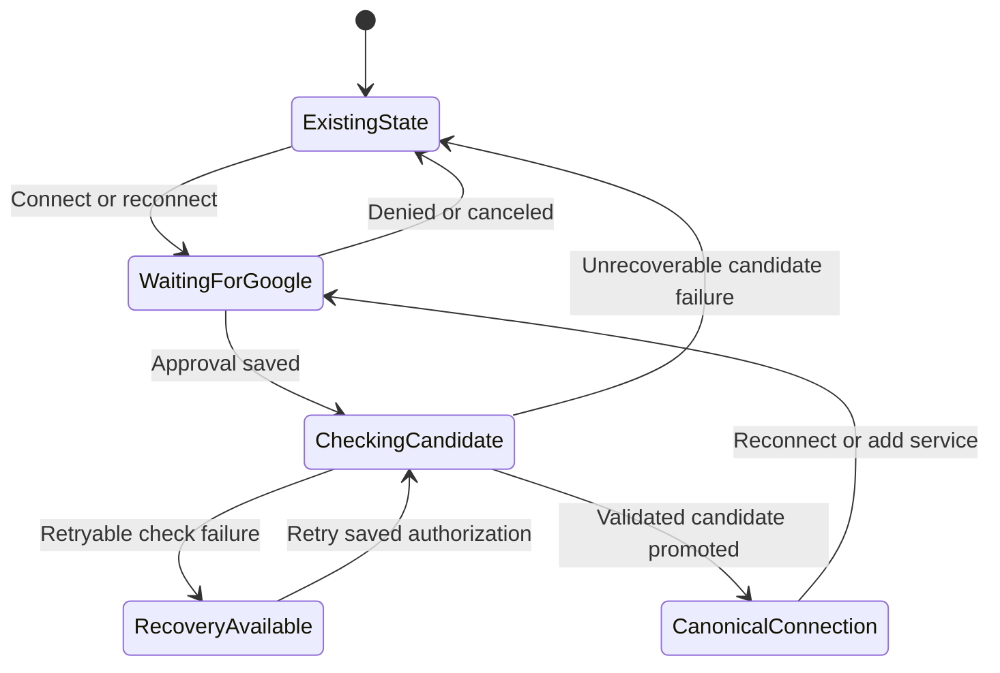

# One Google application; a page for connecting accounts

Date: 2026-09-30

Status: Implemented, provisioned, deployed, and runtime verified on 2026-09-30. See [acceptance evidence](single-project-account-connections-acceptance.md). Account enrollment remains separate from software delivery.

Source inspected: `05731f89` in `/Users/jay/Projects/gogcli-proxy`.

This plan supersedes the project selection, application setup, and account-page direction in the earlier onboarding/stabilization plans. Their authorization, durable-operation, recovery, and credential-promotion requirements still apply. Approach: Ponytail—remove the unnecessary choices and reuse the working account lifecycle.

## 1. Product decision and completion criteria

There is exactly one application for this proxy:

| Fact | Value |
| --- | --- |
| Application name | `gogcli-proxy` |
| Google Cloud project ID | `gogcli-proxy` |
| Project number | `1042630585914` |
| Organization | `kraecollective.com` |
| Support/operator contact | `jay@kraecollective.com` |
| Web-client label | `gogcli-proxy web client` |

The hosted page has one purpose: connect and manage Google accounts for that application. The owner selects services and presses **Connect** for an account. That action records the intended account/services and starts Google consent. There is no additional project assignment, application selection, shared default, or bulk confirmation.

Successful delivery means:

1. All new connections use the canonical application, enforced on the server.
2. The page presents account progress, service choices, the next useful action, and recovery. It contains no Google Cloud setup or software installation workflow.
3. Existing access survives a failed replacement; revoked/paused access stays withdrawn.
4. The working tree contains no obsolete hosted-project identifiers, selectable alternatives, or instructions to recreate them.
5. The shipped flow passes the actual HTTP/browser contracts and production deployment checks.
6. Account enrollment is reported separately: eight connected and checked accounts, or an accurate list of unfinished accounts and the specific next action for each. A software deployment alone does not complete enrollment.

## 2. Evidence and the actual starting point

Read-only production metadata was checked at `2026-09-30T22:37:44Z`, using explicit profile `krae-jdev-dev-prd`, AWS account `968138089939`, region `us-east-2`.

- Eight account records exist. Their saved service choices are Gmail and Drive; Calendar remains optional.
- `jay.jakosky@gmail.com` has a working installed connection through the previous application.
- The other seven accounts are not connected.
- The canonical application's Web-client JSON has not been imported into the proxy. Only a previous application's client record exists.
- No account had an active operation or usable saved recovery. No default-setup record existed.
- Secret values, Google content, and OAuth codes were not read.

The eight accounts are:

| Account | Observed state |
| --- | --- |
| `jay.jakosky@gmail.com` | Existing connection; reconnect to canonical application |
| `jay@frunkholdings.ltd` | Not connected |
| `treasurer@longmonttheatre.org` | Not connected |
| `jay@longmonttheatre.org` | Not connected |
| `jay@krystaljakosky.com` | Not connected |
| `jay@marinasailing.com` | Not connected |
| `jay@frunkfoundation.org` | Not connected |
| `jay@kraecollective.com` | Not connected |

The user has created the canonical project, configured OAuth, saved Gmail/Drive/Calendar scopes, and downloaded its Web-client JSON. The JSON file location, Calendar API enablement, new application's exact publishing status, and audience/test-user configuration remain to be checked during operator setup. Do not restart project creation or treat the previous application's settings as evidence about this one.

Recheck this inventory immediately before rollout; the user can continue using the current page while implementation proceeds.

## 3. Target account page

### Page structure

1. **Connect your Google accounts**.
2. One sentence: “Connect your accounts to gogcli-proxy, owned by kraecollective.com, so your authorized tools can use the services you choose.”
3. Account progress and **Refresh**.
4. Account cards, each with services and a state-appropriate primary action.
5. A small **Add accounts** form accepting comma/newline-separated addresses. Eight is the current roster, not a maximum or eight empty mandatory slots.

Use the existing HTML, CSS, vanilla JavaScript, authentication, and account APIs. Preserve the current page URL. Remove the separate **Connect accounts** button that merely scrolls to another button; users can act directly on an account.

Application identity appears once as text. Do not show a project selector, client ID, AWS ARN, scope URL, or callback in the normal flow. Detailed administrator information is appropriate only when it helps resolve an actual access block.

### Account card

- Email address.
- Plain-language current state and concise next action.
- **Connected services**, derived from installed grants and last service checks.
- Service controls for Gmail, Google Drive, and Google Calendar.
- One primary action, with clear text describing what the Google visit will do.
- Collapsed **Connection options** containing only actions relevant to that account: check, reconnect, pause/resume tool access, disconnect, and Google revocation where applicable.

Use **Connect** for an unconnected account. Nearby text: “Choose this account at Google and approve the selected services. Connecting enables access for your authorized tools.” Remove the initial “Allow my tools to use this account” checkbox and the competing “Connect Google only” action. This records the user's intent through Connect itself.

The server still enforces the existing caller policies and per-account permissions. New/default accounts enable their authorized tools on Connect. An account with saved `desired_owner_access=false` connects or reconnects with access paused, whether or not credentials are currently installed. Show **Tool access: paused** and offer **Resume tool access** after connection; never silently restore withdrawn access. Use state-specific Connect explanation for these accounts instead of promising that tools will be enabled.

Keep email addresses and account order stable across polling. Avoid moving focus or reordering cards when status changes. On return from Google, use the existing nonsecret operation ID to identify and focus that account's result. Refresh/reopen reconstructs progress from the server; merely visiting the page never starts consent.

### Services

| Service | User-facing access description | Initial choice |
| --- | --- | --- |
| Gmail | Read, send, label, and move mail to Trash | Selected for new accounts |
| Google Drive | Read, create, change, share, and delete Drive files | Selected for new accounts |
| Google Calendar | Read, create, change, share, and delete calendars and events | Optional |

Keep `gmail.modify`, `drive`, and `calendar`, plus the current identity scopes. Do not add broader Gmail permanent-deletion or settings scopes. The extra `gmail.drafts` scope is not required by this product flow.

Service choices are requests, not evidence of connection. Selecting Calendar on an installed Gmail/Drive account shows **Reconnect to add Calendar**. Installed services remain selected and cannot be silently removed through reconnect. Explain the existing restriction briefly in Connection options; adding a fine-grained policy editor is outside this change.

### State and primary-action rules

Evaluate active work and recoverability before suggesting a new consent attempt.

| Evidence | Status/action |
| --- | --- |
| No installed connection | **Not connected** → **Connect** |
| Valid, session-bound consent waiting | **Waiting for Google approval** → **Continue Google consent** |
| Consent expired or cannot continue in this session | Explain why → **Restart Google consent** |
| Saved authorization can be checked again | **Connection check needs retry** → **Retry connection** using saved authorization |
| Validation/check/promotion running | **Checking connection…**; prevent conflicting actions on this account |
| Installed connection belongs to the previous application | **Reconnect required for gogcli-proxy** → **Reconnect**; “Your current connection stays available until the replacement succeeds.” |
| Canonical connection works, with added service choices | **Reconnect to add [service]** |
| Canonical connection works with no pending change | **Connected**; show services and last check, with **Check connection** available |
| Installed refresh authorization requires replacement | **Reconnect required** → **Reconnect** |
| Replacement failed but installed connection works | Keep installed status; show “Last reconnect failed” and specific recovery action |
| Tool access is being enabled/removed | Show applying progress until the existing propagation interval finishes |
| Disconnect is running | **Disconnecting…**; do not claim completion before durable removal/propagation finishes |

Count accounts with successfully connected canonical installed state, rather than counting every historical installed credential as completion. Canonical provenance alone is insufficient: pending initial checks and `needs_attention` accounts do not count as completed. During the actual transition the summary can say **0 of 8 connected to gogcli-proxy; 1 existing connection awaiting reconnection**. The personal account card must explain that its existing connection still works. After its successful replacement, the count becomes 1 of 8. API review, a saved draft, or a callback received before successful validation never increments it.

An existing connection with tool access paused remains connected; show access separately. A service check proves the server's named probe at a stated time, not every caller's permissions or every possible Google action.

### Error handling

Every error supplies a next action using observed facts:

- Wrong Google account: name the expected email and offer restart.
- Consent canceled or permissions omitted: explain the missing approval and offer restart.
- Transient validation failure with saved authorization: offer retry without another Google visit.
- Workspace denial: explain that this account's administrator must approve `gogcli-proxy`; reveal exact client/scope details only in contextual help if needed.
- Missing canonical client or required API readiness: “gogcli-proxy is not ready to connect this account. Contact the operator, then retry.” Keep existing account check/access-removal/disconnect functions available.
- Expired owner login: sign in and return to durable account progress. Never reuse an ambiguous authorization-code exchange.

Do not send account users to create Google Cloud projects, import JSON, review Branding, or configure APIs. Retain Testing support. If operational evidence establishes Testing expiry applies, state the reconnect requirement honestly; publishing and organization trust are operator concerns, not page checkboxes.

## 4. Remove the application portal

Delete, rather than collapse or relabel:

- Shared and per-account project selectors.
- **Use this app for all accounts**, its default write, account-retarget loop, partial-assignment state, and tests that only protect that obsolete workflow.
- **Application settings**, the numbered Google setup steps, Console links, suggested names, callback copying, JSON upload, API confirmations, publishing checkbox, and routine administrator-instructions panel.
- CLI configuration instructions and raw caller-role ARN from the account page. Keep technical connection instructions in the appropriate repository/operator documentation.
- Browser draft project IDs, project dirty/revision tracking, project rendering, global readiness navigation, and event handlers for removed controls.
- CSS used exclusively by removed setup controls, after checking remaining uses.

The result should substantially shrink `app.js`. Reuse the request/session, account draft, operation, recovery, polling, and accessible-status code. Prefer native controls. Split a source file only if remaining responsibilities require it; do not introduce a framework, generic wizard, new administration page, or new state library.

## 5. Make the backend singular

### Configuration and records

Replace `existing_google_projects` with one singular Google-application entry in `env/gogcli-prd/binding.json`, recording the canonical ID, number, and organization. Pass only the values actually consumed by the runtime. Replace `GOOGLE_EXISTING_PROJECTS` with a singular required project-ID binding; fail closed if it is missing. Do not retain a fallback to a historical app.

Reuse `CLIENT#gogcli-proxy` and the existing encrypted immutable revision secrets. This is one application record with replaceable client revisions, not a project catalog. Read that record directly; stop enumerating `CLIENT#` rows to build selectable applications.

Remove `SETUP` default reads/writes and account `selected_project_id` choices. New accounts and new enrollment commands derive the application on the server. Existing obsolete selection attributes are ignored; do not run an account rewrite simply to remove unused fields.

Remove the hardcoded account-to-project seed dictionary. The eight persisted account records are authoritative. An empty environment should show an empty account list and Add accounts, rather than synthesizing historical account records. Keep the expected production roster in operational documentation and test fixtures where useful.

### Public HTTP contract

Keep the existing authenticated `GET /v1/setup` endpoint as the account-page snapshot; renaming a working URL is unnecessary. Keep owner authentication, CSRF/Origin checks, account commands, operation URLs, and Google callback paths.

The snapshot contains:

- CSRF token and minimal read-only application identity/readiness.
- Supported service choices and safe descriptions.
- Account metadata, installed-service evidence, requested services, desired access, recoverability, and current operation summaries.
- A server-derived indication that an installed connection uses the current application. The page needs this fact, not the old project's name.

Remove `projects`, `defaultProjectId`, recorded Desktop-client metadata, editable project fields, and unused callback/CLI configuration information from this page contract. Readiness must describe configured client/API confirmations accurately; it is not proof Google will allow an account.

Delete `PUT /v1/setup` and both `/v1/projects/{projectId}/…` mutation routes. Do not retain aliases or hidden compatibility endpoints. Remove `projectId` from new account-save and enrollment bodies and reject it as an unknown field on new commands. Add narrow unknown-field validation to account-save, which currently lacks it. Keep service selection, idempotency, restart, and the account access lifecycle as applicable; normal initial Connect enables tools except where an existing saved pause must be preserved.

New enrollment always resolves the canonical record before consent. Preserve the original request fingerprint and continuation body/key for an accepted command. Perform the existing idempotency replay lookup before validating a new request's fields: an exact replay returns already accepted work, while any fresh command containing `projectId` is rejected. A changed fingerprint still fails. Expired consent starts a fresh canonical request. This preserves durable command semantics without accepting new alternate-project requests. The existing enrollment operation already records intent; no separate assignment operation is needed.

Update `docs/onboarding.openapi.yaml` in the same commit as the handler contracts. Document removed fields/routes as a breaking owner-page contract change. The page and API ship together; stale tabs receive a safe reload-required/invalid-request response and cannot select another application.

### Installed credentials and recovery

Keep immutable OAuth facts where they are necessary for correct refresh, callback validation, recovery, and audit: client references, client revisions, installed provenance, saved scopes, account generations, and effect leases. Old installed state must not be relabeled as canonical. These runtime facts do not create a selectable second application in the repository or page.

The existing candidate-validation/promotion mechanism remains authoritative:

`ExistingState` can be an unconnected account or a working installed connection. Replacement work leaves its credentials intact until successful promotion. Restrictive access/disconnect commands retain their existing generation fences and propagation semantics.

The observed live state needs no active-operation migration. Recheck all attempts before deployment, including canonical-app attempts created by the old page: they also contain old request fields. Already accepted work keeps its pinned client, original request, and callback/recovery path. The original continuation request is historical operation data, not an application choice. It can be returned for exact replay without exposing a project selector or alternate application metadata. Explicitly resolve any work that cannot safely resume; do not rewrite fingerprints, erase callbacks, or add a generic migration. Test the old-page-to-new-handler boundary so a consent started during deployment cannot be stranded.

## 6. Finish application provisioning outside the page

The canonical JSON is still an actual prerequisite. Removing its browser upload requires a concrete replacement in the same implementation.

Add one local operator command, exposed through the existing Justfile, backed by a small script such as `scripts/configure_google_application.py`:

1. Resolve the explicit source repository, environment binding, access record, AWS profile/account/region, and fixed canonical application.
2. Read Google's downloaded JSON from an explicitly supplied local file. Never accept its secret value in a command-line argument or print the file.
3. Reuse `validate_web_client` to require a Web client, exact canonical project ID, standard Google endpoints, and the permanent callback.
4. Reuse `Store`, immutable revision-secret creation, and revision-conditioned API confirmation. Refactor the current import/review mechanics into operator-callable functions as needed; remove their public HTTP entrypoints. Application configuration is deployment-owned, so provisioning must not fabricate an account owner identity.
5. Confirm only the APIs actually checked in this Google project. Record publishing status as information; Testing remains permitted. A Web JSON file alone does not prove API enablement, organization ownership, or production status.
6. Return only nonsecret project, revision, and readiness information. Reuse a recorded canonical revision when its saved immutable credential equals the supplied validated credential, and finish its revision-bound review. A failure after secret creation but before recording the revision may leave an unreferenced encrypted secret; it must never report readiness. A retry can create a new revision in that case. Avoid a new provisioning workflow solely to eliminate harmless orphan writes, and never print credential comparisons or values.

Keep it local/operator-only; use existing AWS access and encrypted SSM storage. Do not add another web page, Lambda administration route, credential store, permission model, or general-purpose Google Cloud automation tool.

The operator runbook starts from the existing project. It records the known names and exact callback, how to import/replace its client, confirm Gmail/Drive/Calendar API enablement, and check Audience/Test users or publishing. It must explicitly distinguish project ownership (`kraecollective.com`) from the callback's authorized domain (`k-rae.com`).

Long-lived personal-account access requires handling the actual External Testing state. Check the new application's status before claiming durable authorization. The documented Workspace Trusted exception applies only to the relevant organization's users; it does not solve personal Gmail expiry. Do not block all enrollment on Production, invent branding URLs, or promise that Google will never require consent again.

## 7. Repository cleanup

| Surface | Required change |
| --- | --- |
| `env/gogcli-prd/binding.json`, `infra/stacks/onboarding_resources.py`, infrastructure contracts | One canonical binding; remove historical contexts and recorded client IDs |
| `onboarding.py`, `onboarding_operations.py`, `onboarding_commands.py`, `onboarding_services.py` | Singular app, account-only public commands/snapshot, no default/project selection or synthetic project-account seeds |
| `onboarding_google.py`, `onboarding_store.py`, operator script | Reuse validation and safe revision writes; preserve trust boundaries |
| `assets/onboarding/index.html`, `app.js`, `style.css` | Account-only layout and actions; delete portal code |
| HTTP/backend tests and both browser fixtures | Replace obsolete project/setup journeys with canonical account journeys |
| `docs/account-onboarding.md`, `docs/onboarding-usability.md` | User instructions start with choosing services and Connect; explain statuses/recovery |
| `docs/onboarding.openapi.yaml` | Match the singular owner contract and removed routes/fields |
| `infra/README.md`, relevant proxy sections of `README.md`, `docs/install.md`, `docs/auth-clients.md` | Separate operator setup and caller integration from the account page |
| Earlier files under `planning/proposed_plans/` | Mark the superseded scope and remove contradictory project catalogs/defaults/page-creation instructions; retain still-valid stabilization requirements and truthful historical evidence |
| Local ignored root `SKILL.md` / retained local planning notes | Replace obsolete operational rules without adding these files to Git |
| `CHANGELOG.md` | Describe the resulting single-application account flow and owner-contract change |

Search the current tracked tree for the removed Google project IDs, old Desktop client ID, obsolete Console/project-selection instructions, and old generated callback recommendations. Remove matches that belong to this hosted proxy, including stale historical plans. Git history preserves superseded details; do not rewrite history or rename unrelated upstream Google Cloud examples to this project.

Generic upstream gogcli multi-client capabilities and unrelated services such as Pub/Sub retain their own contracts. Removing them would be unrelated product work. The hosted proxy must have no path by which those capabilities select a different onboarding application.

## 8. Implementation sequence and ownership

1. **Freeze the contract and baseline.** Save this plan to a unique `/tmp/gogcli-single-app-plan.*` file before implementation. Record the worktree, source commit, exact deployment target, and read-only current account/client/operation facts. Agree the minimal snapshot and removed request fields before agents edit their consumers.
2. **Backend/operator workstream.** Write focused failing tests for fixed-app resolution and obsolete-route/field rejection; implement singular resolution and the local provisioning command. Preserve existing lifecycle tests. Own backend and operator files.
3. **UI/journey workstream.** Using the agreed snapshot, first adapt a browser regression to fail on the old page, then remove setup controls and implement the account states/actions. Own assets and browser fixtures. Exercise real handler contracts, not only a synthetic snapshot.
4. **Configuration/docs workstream.** Narrow binding/infra, update OpenAPI with backend coordination, rewrite account/operator docs, and purge obsolete current-tree references. Own documentation/IaC tests; avoid overlapping application edits.
5. **Integrate.** Review all diffs, reconcile shared contracts, run the focused checks below, and commit only attributable task changes. Use the user's requested `gpt-6.1-sol` medium agents for independent workstreams; the parent owns integration and verification.
6. **Provision and release.** Supply the downloaded canonical JSON through the local operator command, verify its exact target/readiness, recheck operations, deploy the committed application to the existing environment, and verify the live runtime.
7. **Enroll.** Guide one personal-account replacement through Google and verify it, then continue the remaining seven accounts. Present actual account-specific blockers as they occur. Do not invent a batch Google-consent operation.

## 9. Acceptance checks

Use existing meaningful tests wherever they already prove the contract. Red → Green applies to changed behavior; documentation-only changes need lint/link/diff checks, not new behavior tests.

| Boundary | Required proof |
| --- | --- |
| Singleton resolution | All eight accounts and a newly added account start consent with the canonical client regardless of obsolete stored selections; old client rows never become choices |
| Removed contract | Project/default mutation routes are unavailable; obsolete `projectId` input on new commands is rejected; no new alternate-project enrollment |
| Empty/read-only snapshot | No implicit three-account seeding, no writes on GET, minimal application readiness, no secrets or alternate applications in current app metadata/rendered page |
| Operator provisioning | Real parser rejects Desktop/wrong-project/wrong-callback/invalid endpoints; stale review revision fails; interrupted write does not report ready; outputs/logs exclude secrets |
| Initial journey | A preconfigured app loads eight cards; select services → Connect → intercepted Google consent using fixed client, with no intervening app/default/setup action |
| Return/reopen | Accepted progress survives reload; Google callback returns focus to the correct card; account count changes only after successful validation/promotion |
| Prior working connection | Old installed credential remains usable on denied/failed replacement; canonical success replaces it and updates progress truthfully |
| Services | Gmail/Drive defaults preserved; Calendar optional; Calendar-only and added-Calendar consent/probes correct; selecting a service does not present it as installed |
| Recovery | Correct priority of continuation, restart, saved recovery, checks, and new consent; saved code is not exchanged twice; recovery survives operation expiry; old-page exact replays/callbacks complete across deployment for both historical and canonical clients without accepting new project-bearing commands |
| Access | Normal initial Connect enables intended authorized tools; an existing saved pause survives first consent and reconnect; delayed work cannot restore withdrawn access; disconnect respects propagation |
| Failure scope | Missing app or Calendar API does not remove working-account controls or block unrelated Gmail/Drive work; safe actionable error copy |
| Interaction | Independent accounts remain usable, drafts survive refresh, no lost focus, keyboard operation and 390px layout pass, absent setup controls cannot be reached |
| Deployment | Linux/Python 3.11 x86_64 package verified; deployed source/assets match committed files; fixed callbacks/auth guards intact; stack/Lambdas successful |

Practical commands include `just proxy-test`, the existing two named `agent-browser` journeys, infrastructure contracts, `test_python_asset.py`, and `make docs-check`. Run PyYAML consumers with `uv run --with pyyaml`. Run Go/CLI tests only where a changed consumer or unresolved integration concern warrants them.

Keep the existing offline Google interception assertion so a browser test cannot accidentally navigate to real consent. Failure paths use fixtures; production checks read metadata and bounded service endpoints. Verify an actual selected-service connection only after the user grants consent. Do not create, send, share, or delete Google content to prove this UI change.

## 10. Release and cutover

Source: committed `/Users/jay/Projects/gogcli-proxy` changes integrated into its current branch.

Target: `gogcli-prd`, AWS account `968138089939`, region `us-east-2`, stack `GogcliGoogleProxyApi`, profile `krae-jdev-dev-prd`.

Retain these addresses:

- Page: `https://gp-039168171bf05570eadba6a8.k-rae.com/prd/onboarding/`
- Google callback: `https://gp-039168171bf05570eadba6a8.k-rae.com/prd/onboarding/oauth/google/callback`
- Owner callback: `https://gp-039168171bf05570eadba6a8.k-rae.com/prd/onboarding/auth/callback`

Before deployment, require the canonical client and relevant API review to exist, inspect pending work, and compare synthesized changes. No account table, hostname, certificate, DNS record, or API identity replacement is needed. No additional central JDev grant is required for this simplification.

Deploy through the existing CDK command and explicit profile. Check the stack and both Lambdas, compare packaged source/assets, verify public cache/auth behavior, and inspect the authenticated snapshot without printing secrets. The account page should present all eight records and only the canonical application. Refresh a previously open tab to exercise removal of the old owner contract.

Then reconnect the personal account using the normal page action. Check the resulting installed project, service authorization/read evidence, and actual authorized caller access. Keep a failed attempt distinct from the existing connection. Continue other accounts with their saved choices, adding Calendar where selected by the user.

Repository cleanup does not revoke Google consent or delete installed secrets. Remove unused previous client metadata/secrets only after checking that no installed account, operation, or saved recovery references them and treating any destructive cleanup as a separate authorized action. There is no need to delete unused runtime rows to ship this product simplification.

If a deployment needs rollback, restore the previous application artifact through the existing deployment mechanism; preserve all durable account/client records. A rollback must not trigger reconnects, discard callback artifacts, or revoke working credentials.

## 11. Handoff

The implementation report should state the deployed URL, the eliminated choices, verification results, and the actual account enrollment status. Keep the user's next step to one account action at a time.

Planning is complete when this document has been reviewed and saved. Implementation is complete only when the singular account page is deployed and its runtime checks pass. The eight-account objective is complete only when the resulting connections are verified or the user has explicitly chosen to leave identified accounts unresolved.
